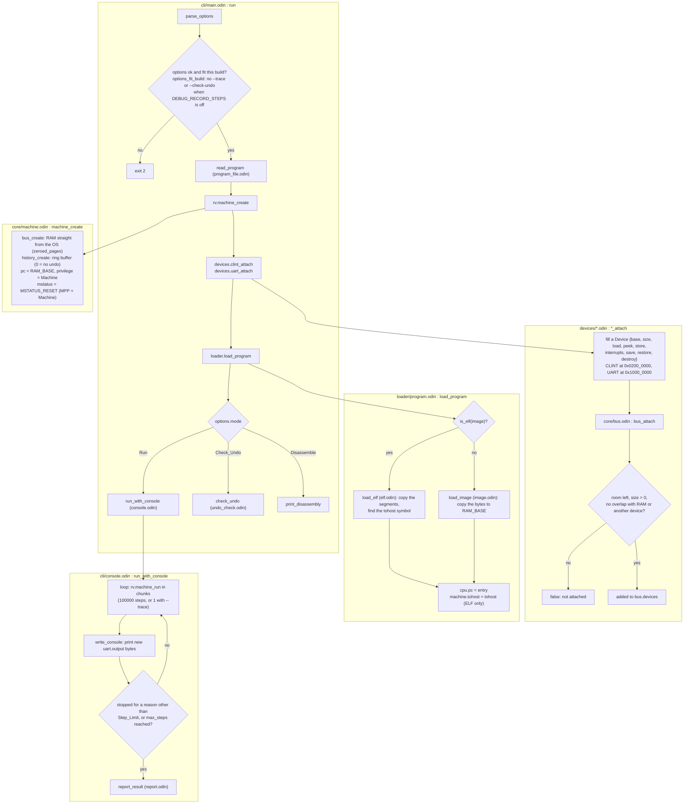
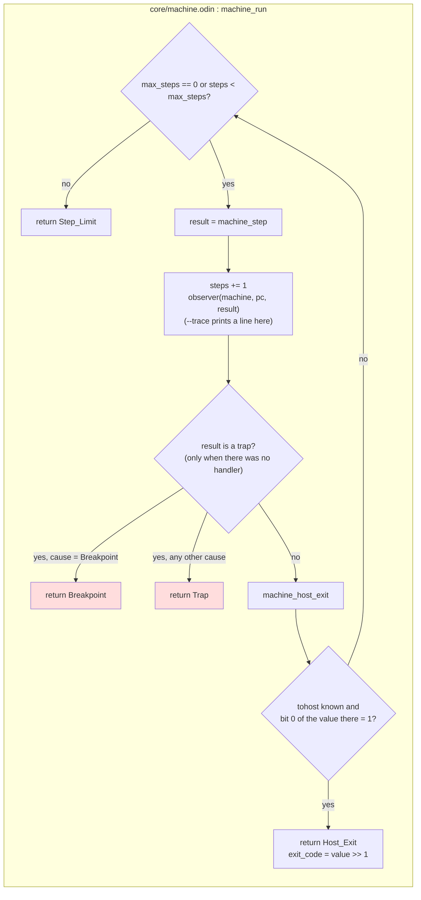
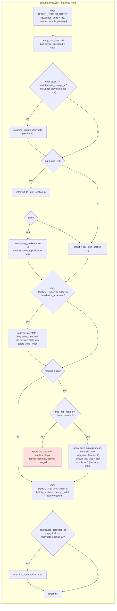
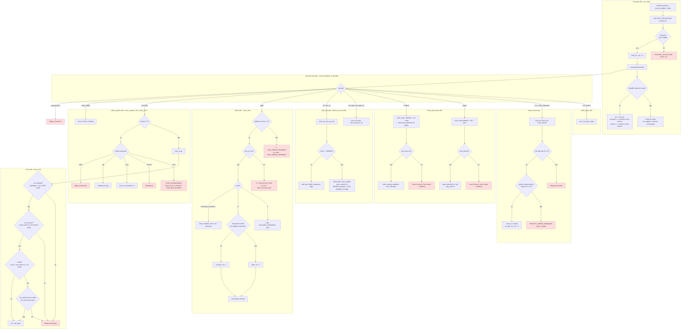
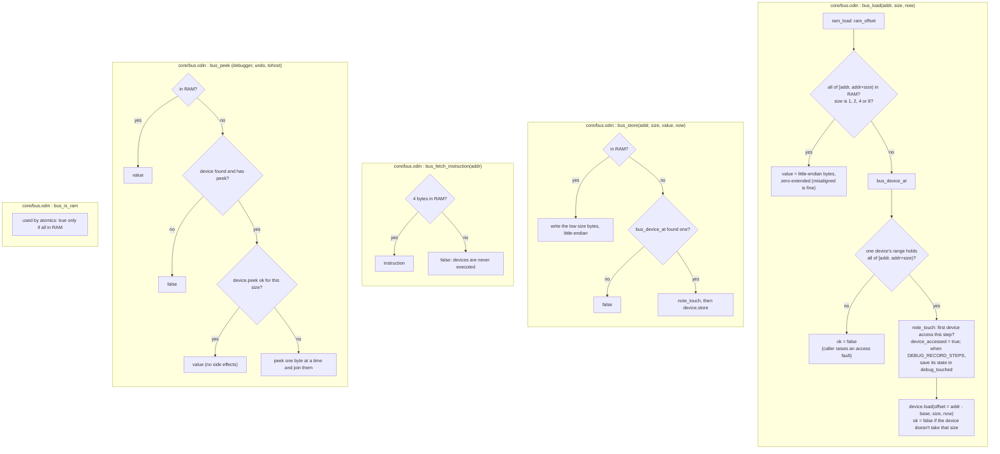
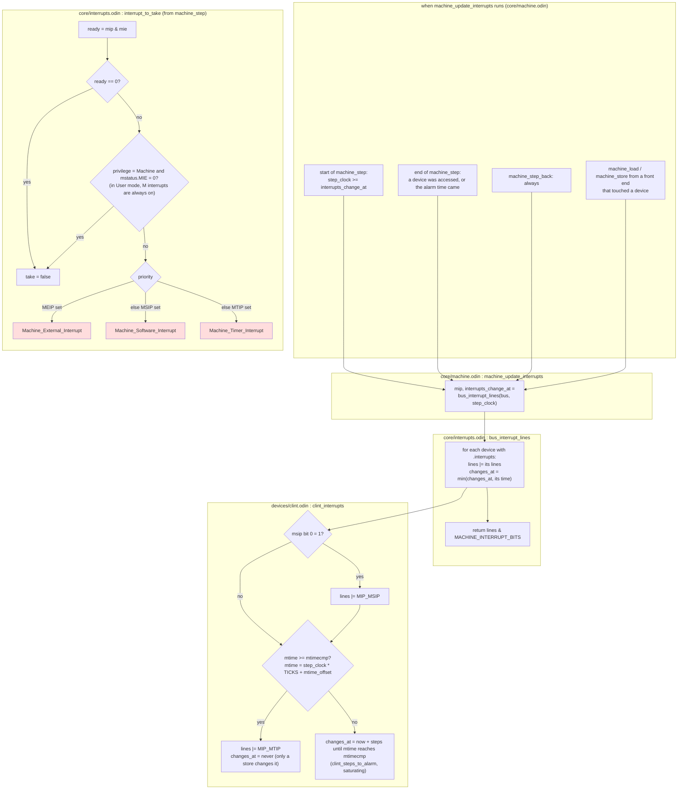
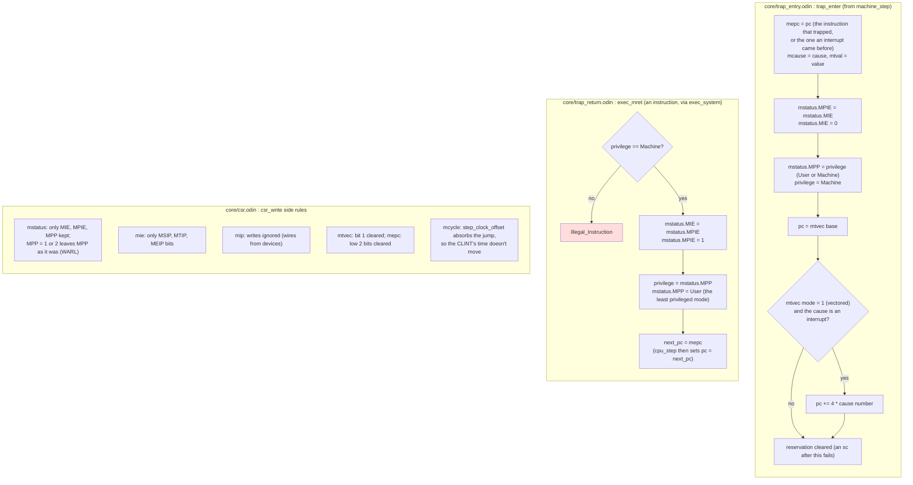
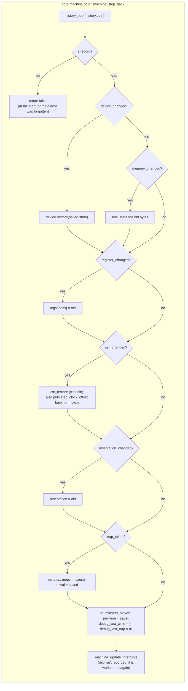

# How the machine works

Flowcharts of the emulator, grouped by file and function. Each box
named `file : function` is a subgraph; a diamond is a condition; an
edge label says which way the condition went. Red boxes are traps.

1. Start-up (cli)
2. The run loop (machine_run)
3. One step (machine_step)
4. One instruction (cpu_step, execute and the handlers)
5. The bus (load, store, fetch, peek)
6. Interrupts (CLINT -> mip -> interrupt_to_take)
7. Trap entry and mret
8. Step back (undo)

---

## 1. Start-up

---

## 2. The run loop

The debugger doesn't use machine_run: its Next button calls
machine_step once, and Prev calls machine_step_back.

---

## 3. One step

A step is either one instruction or one interrupt taken. A trap with
a handler is a normal step (the pc moves to mtvec); a trap with no
handler (mtvec = 0) stops the machine and changes nothing.

---

## 4. One instruction

Every handler checks first and writes last, so a handler that returns
a trap has changed nothing. Registers change only through reg_write
(which drops writes to x0), memory only through the bus.

---

## 5. The bus

---

## 6. Interrupts

mip is not stored by software: it is recomputed from the devices
(machine_update_interrupts), and only when something could have
changed it.

---

## 7. Trap entry and mret

---

## 8. Step back (undo)

Only in builds with DEBUG_RECORD_STEPS (the debugger, rvemu-check).

